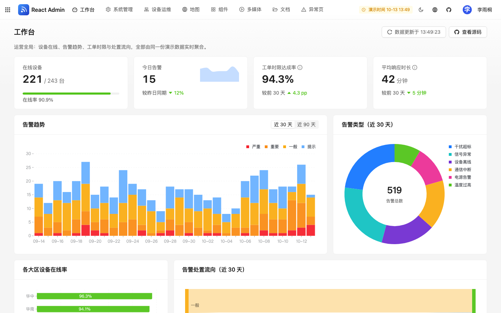
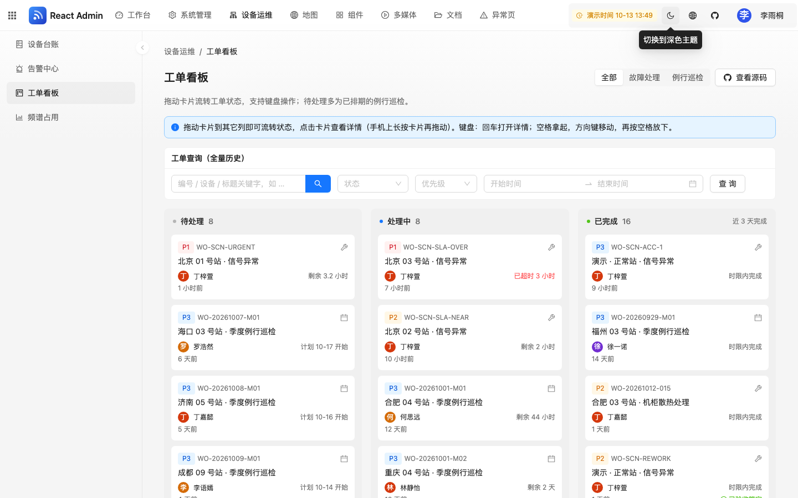
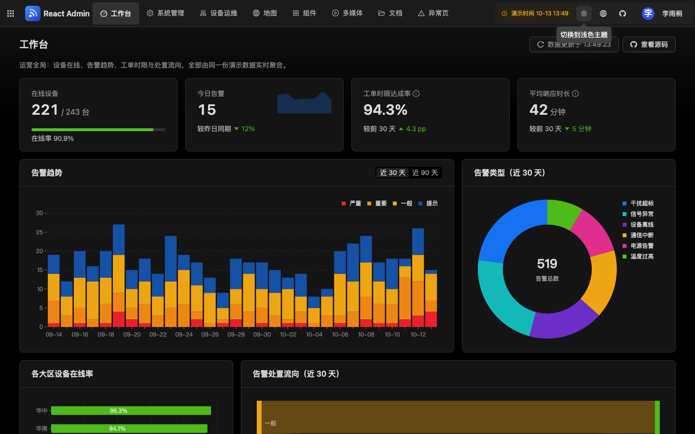
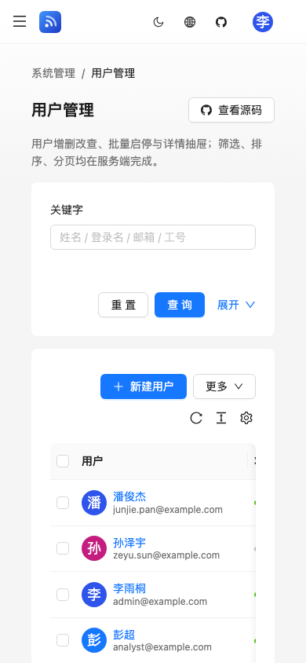

#  umi-react-admin

> **中文文档**：[README.zh-CN.md](./README.zh-CN.md) · 简体中文完整文档在此，欢迎翻译 PR。

<!-- ALL-CONTRIBUTORS-BADGE:START - Do not remove or modify this section -->

[](#contributors-)

<!-- ALL-CONTRIBUTORS-BADGE:END -->

[](./LICENSE) [](https://github.com/Jerry-CodeHub/umi-react-admin/actions/workflows/deploy.yml) [](./CONTRIBUTING.md)

`umi-react-admin` is an open-source admin template built on **Umi Max 4 + React 19 + Ant Design 6 + ProComponents**. Unlike most templates, its demo tells **one coherent story**: a fictional IoT monitoring platform — 240+ stations, ~90 days of alarms, tickets derived from those alarms, 86 operators with role-based permissions and audit logs. Every number on the dashboard is aggregated live from those records, and holds up to scrutiny.

**[Live demo](https://jerry-codehub.github.io/umi-react-admin/)** — one-click sign-in for five roles (`admin` / `lead` / `operator` / `analyst` / `guest`) sharing the same dataset, so you can compare permission differences across menus, buttons and API responses (see `docs/demo/role-matrix.md`).

| Group | Pages |
| --- | --- |
| Dashboard | KPIs (online devices, alarms today, SLA rate, avg response), alarm trend, type mix, regional online rate, disposition flow, device health, distribution, latest activity |
| System | Users (filter / sort / batch / detail drawer), roles (permission tree), audit logs, access demo (route-level / button-level / data-level) |
| Operations | Device registry, alarm center (convert to ticket / recover / false positive), ticket board (drag & drop, keyboard accessible), spectrum occupancy (D3) |
| Maps | AMap, OpenLayers (same station set); six Cesium scenes: GeoHash grid, direction & distance, heatmap, routes & coverage, box-select & measure, air/sea situation |
| Components | Calendar (FullCalendar), rich text (self-hosted TinyMCE with data-generated weekly report), signature (ticket acceptance), page screenshot (html2canvas) |
| Media / Documents | Video, music player, waveform; browser-side monthly PDF report and Excel import/export (row-level validation) generated live from the data |

Fully bilingual (zh-CN / en-US), light/dark themes, mobile-friendly; every page has a "view source" link in the top-right corner.









> Screenshots are from the 2026-10-12 demo walkthrough (more in [docs/demo/screenshots/](./docs/demo/screenshots/)).

## Contents

- [Requirements](#requirements) / [Getting started](#getting-started) (incl. [Environment variables](#environment-variables))
- [Scripts](#scripts) / [Directory layout](#directory-layout) / [Features](#features)
- [Deployment](#deployment) / [Third-party licensing notes](#third-party-licensing-notes) / [Analytics & privacy](#analytics--privacy)
- [Contributors](#contributors-) / [Changelog](./CHANGELOG.md) / [10-minute demo script](./docs/demo/demo-script.md)

## Requirements

- Node.js 24 LTS (see [.nvmrc](./.nvmrc); nvm / fnm recommended); minimum 22.22.2 (engine requirement of jsdom, Cesium and friends)
- pnpm 11 (the `packageManager` field pins the version; pnpm 10 auto-switches); releases younger than 24 hours are rejected by pnpm 11's default `minimumReleaseAge`
- Developers in China may configure a registry mirror in `~/.npmrc` (this repo's `.npmrc` intentionally carries none)

## Getting started

```bash
git clone https://github.com/Jerry-CodeHub/umi-react-admin.git

cd umi-react-admin

# Copy the env template and fill in as needed (see environment variables below)
cp .env.example .env.local

pnpm install

pnpm start
```

### Environment variables

| Variable | Required | Notes |
| --- | --- | --- |
| `CESIUM_ION_TOKEN` | Optional | Your own public web token, restricted by origin and quota; without it the app falls back to HTTPS OSM (no SDK-shared token). Ion terrain requires your own token |
| `UMI_APP_DEMO_MODE` | Required for demo | Only `true` enables the pure-frontend demo; unset or `false` means real mode. `.env.example` enables the demo explicitly |
| `UMI_APP_API_BASE` | Required for real builds | Same-origin API path prefix such as `/` or `/backend`; cross-origin backends must be proxied at a same-origin entry. Mutually exclusive with demo mode |
| `AMAP_KEY` / `AMAP_SECURITY_CODE` | For AMap features | Your own public web key restricted by origin and quota; without it the SDK is not loaded and no library-shared key is used |
| `EXPECTED_CESIUM_TOKEN` / `EXPECTED_AMAP_KEY` / `EXPECTED_AMAP_SECURITY_CODE` | When the matching credential is injected into a build | Typed declarations for the post-build artifact scan: every build-time credential (`CESIUM_ION_TOKEN` / `AMAP_KEY` / `AMAP_SECURITY_CODE` in [config/config.ts](./config/config.ts)) must be declared as intentionally public before the artifact is deployed. The scanner compares SHA-256 fingerprints only — it never prints or logs the value — and fails closed when a credential is injected but undeclared, when a declaration is malformed, when a declaration differs from the artifact, or when a declaration has no artifact counterpart. `EXPECTED_TOKEN` is a deprecated alias for the Cesium token only |
| `CLARITY_ID` | Not supported | The template lacks consent, content masking and matching CSP integration; setting it fails the build. No analytics scripts by default |

## Scripts

```bash
pnpm start             # Dev server (port 8000; reads the explicit mode from .env.local)
pnpm start:demo        # Dev with the demo backend explicitly enabled
pnpm build             # Real-mode production build: requires a same-origin API (UMI_APP_DEMO_MODE=false, UMI_APP_API_BASE=/)
pnpm build:real        # Same as above with the mode pinned explicitly; the CI matrix builds it to assert demo code is stripped
pnpm build:demo        # Public demo build (primary pipeline: Vercel / Docker)
pnpm build:github:demo # Public demo build for GitHub Pages (sub-path /umi-react-admin/)
pnpm check             # typecheck + strict lint + vitest (run before every commit)
pnpm test              # vitest units (demo data sanity, API, CSP consistency, route table)
pnpm test:coverage     # vitest with the coverage gate; the percentage covers the selected include set in vitest.config.ts, not the whole project
pnpm e2e               # Playwright: per-route smoke on the build:github:demo output + English completeness + key flows
pnpm e2e:build         # Build once, then run e2e
pnpm size              # Public demo build + bundle-size budget gate (size-budget.json)
pnpm audit:security    # Full raw dependency advisories + installed patch verification with attack regressions
pnpm analyze           # Build with a bundle composition report
pnpm format            # Prettier
```

## Directory layout

```
src/
├── pages/            # Pages grouped by menu (Dashboard / System / Ops / Map / Components / Media / Document / Exception)
├── components/       # Shared components (DemoPage shell, ChartCard, CesiumViewer, GuideTour, ErrorBoundary…)
├── demo/             # In-browser demo backend: data generator, patch store, REST routes, axios adapter
├── services/         # API calls and the shared frontend/backend contract (types.ts)
├── hooks/            # useApi / useChartTheme / useEnums / useThemeMode
├── locales/          # zh-CN / en-US messages (split by domain; key parity enforced by tests)
├── constants/        # Enum order, semantic colors, permission tree
├── layouts/          # Top bar
└── utils/            # Request layer, formatting, map math (geodesy / geohash / turf merged)
config/               # umi config, routes (with legacy redirects), single-source CSP, chunking, build info
e2e/                  # Playwright specs
```

## Features

- **Demo backend**: browser-resident demo APIs (`src/demo`, wired in via an axios adapter) used only when `UMI_APP_DEMO_MODE=true`. The login token lives in the current tab's sessionStorage; modifications to the fictional business data persist as patches in localStorage, and the avatar menu offers "reset demo data". Do not import real business or sensitive data. Data is generated deterministically per calendar day; the window slides with today.
- **Data plausibility**: `src/demo/generate.test.ts` encodes the rules as assertions — level ratios, weekday/weekend rhythm, timeline ordering, device-status ↔ active-alarm correspondence, KPI/agreement parity, example.com-only emails, masked phone numbers, documentation-reserved IP ranges.
- **Real backend**: disable the demo, set a same-origin `UMI_APP_API_BASE`, and implement the endpoints per [src/services/types.ts](./src/services/types.ts). The frontend expects server-side session cookies; login returns user info, no bearer is stored. The cookie/CSRF/server-auth/TLS contract lives in [SECURITY.md](./SECURITY.md); there is no backend implementation in this repo. Real production builds fail without a backend configured, and real-mode pages never show demo shortcuts.
- **Auth & permissions**: permission points for the five roles (admin / lead / operator / analyst / viewer) are defined in `src/constants/permissions.ts` and act as the **single authorization source** for menus, buttons and the in-browser demo API — the demo backend resolves them per request from the role record, so permission edits apply to existing sessions immediately. Assigning a role is a separate permission (`system.user.role.assign`, held by admin only in the default matrix): it is the only way to write a user's `role` (user creation, a profile update carrying `role`, or an import row whose role cell is not blank — blank role cells import as viewer, and if any row assigns a role without the permission the whole request fails with 403), changing your own role returns 403 for every identity including admin, and the assignable set is bounded to `viewer` / `operator` / `analyst` — accounts that currently hold admin or lead cannot be re-roled through this path either. Editing role permissions is bounded the same way: a holder of `system.role.update` cannot edit or reset the role they belong to, and can only grant permission keys they hold themselves. Exact device coordinates are a data-level permission (`ops.device.coordinate.view`): without it the API coarsens coordinates to a 0.1° grid while serializing and marks them `coordinatePrecision: 'coarse'`, so the UI never performs the masking. State-changing demo routes write audit logs carrying actor / action / target / result / time: login/logout, user create/update/disable/delete, role assignment, role update/reset, bulk import, alarm handling, ticket assign/start/return/close/accept/rework, schedule create/update/delete and demo-clock switches. Two privileged routes are deliberately **not** logged — `POST /api/v1/demo/reset` and `POST /api/v1/demo/scenario` clear the patch store (the log table included), so a log written there would be erased immediately. The five experience accounts (`admin`, `guest`, `lead`, `operator`, `analyst`) and the signed-in account itself are protected: they cannot be disabled or deleted (single or batch) and cannot be renamed (the demo session is keyed by username, so the signed-in account cannot change its own username). Accounts whose current role is admin or lead are maintained by administrators only: a delegated role holding `system.user.update` / `system.user.delete` (lead included) gets 403 when it tries to disable, enable, delete or edit them — single and batch requests alike, and one such account fails the whole batch — and the Users page greys those rows out. The full matrix is in [docs/demo/role-matrix.md](./docs/demo/role-matrix.md). Demo mode never validates passwords; a real backend must still authorize every operation and data scope itself. Login redirects are normalized and confined to this app.
- **Document input**: XLSX capped at 5 MiB / 16 MiB actual decompression / 16 sheets / 1000 rows / 64 columns / 4096 chars per field; XML merges and named ranges are checked before allocation. Parsing runs in a terminable worker with a 10s timeout. PDF capped at 20 MiB / 1000 pages, two-page render window, image and canvas budgets checked; switching files cancels the previous task. The Excel **import API** re-validates the whole request before any write: at most 1000 rows, 8 fields per row, 256 chars per field, 200,000 chars of aggregate text and a 5 MiB serialized body, against a field allowlist plus the numeric `row` metadata field. Structural violations return 400 and budget violations 413, and a malformed request performs zero writes (no partial import).
- **i18n & theming**: bilingual UI (first visit follows the browser language); writing Chinese literals in code is blocked by an ESLint rule, and e2e asserts the English UI has no leftovers. Charts, maps, calendar and rich text all follow the light/dark theme.
- **Build info**: the footer shows the build commit and time; `dist/version.json` is generated from the same source so you can verify the deployed version.
- **Accessibility**: `<html lang>` follows the UI language, pinch-zoom is allowed; the top bar and the ticket board are keyboard-operable; icon buttons have accessible names.
- **Browser baseline**: Chrome 111+ / Firefox 128+ / Safari 16.4+ (Tailwind CSS 4); the PDF page needs native `Promise.try` (Chrome 128+ / Firefox 134+ / Safari 18.2+).

## Deployment

Vercel, Docker and Cloudflare Pages enforce CSP plus `X-Content-Type-Options`, `Referrer-Policy`, `X-Frame-Options`, `Permissions-Policy` and HTTPS HSTS. The CSP source list lives in [config/csp.ts](./config/csp.ts); the three static header copies (`vercel.json`, `nginx/security-headers.conf`, `public/_headers`) are compared header by header by tests, and production HTML carries a meta CSP too. `script-src` is narrowed to `'self'` + `'unsafe-eval'` + the single loader host `https://webapi.amap.com` — the only host the installed `@pansy/amap-api-loader` injects `<script>` from, derived from its source by `scripts/csp-amap-pinning.test.ts`. `img-src` / `connect-src` still allow `https://*.amap.com` and `https://*.autonavi.com` because tiles and data services are image/XHR loads, not script sources. `'unsafe-eval'` serves the Cesium Knockout controls and inline styles serve antd; those compatibility needs require keeping the checks on third-party versions and every HTML input boundary. The GitHub Pages meta CSP cannot provide header-grade frame protection, so Pages hosts the public demo only.

Every build that will be deployed is scanned for leaked credentials after the build and before publish. Each build-time credential must be declared as intentionally public via `EXPECTED_CESIUM_TOKEN` / `EXPECTED_AMAP_KEY` / `EXPECTED_AMAP_SECURITY_CODE` ([scripts/check-dist-secrets.mjs](./scripts/check-dist-secrets.mjs)); the scan only prints SHA-256 fingerprints and file paths, and fails closed on an injected-but-undeclared credential, a malformed declaration, a declaration that differs from the artifact, or a declaration with no artifact counterpart. Config defines derived from `process.env` indirectly (through variables, destructuring, functions or local modules) are traced too, and any `UMI_APP_*` variable outside the registered public ones fails the scan, because umi injects that prefix into the bundle without the define block. A second layer flags non-JWT key shapes (AWS / GitHub / Slack / `sk-` prefixes, PEM private key blocks) with no allowlist.

- **GitHub Pages**: pushing `master` triggers [deploy.yml](./.github/workflows/deploy.yml) automatically. Build, full dependency audit and artifact scanning run in a read-only job; only the publishing job — which downloads the checked artifacts — gets write access. `build:github:demo` enables the public demo explicitly; real mode refuses this target. A copied `404.html` supports sub-routes. After the scan the pipeline writes a per-file SHA-256 integrity manifest ([scripts/verify-dist-integrity.mjs](./scripts/verify-dist-integrity.mjs)) outside `dist`, uploads it inside the same artifact, re-checks the manifest digest against the build job output, and re-verifies every file before publish — a missing, extra, changed, symlinked or size-mismatched file fails the deploy. After deploy the pipeline verifies `version.json` and runs the online `@smoke` suite.
- **Vercel**: see [vercel.json](./vercel.json). The public demo sets `UMI_APP_DEMO_MODE=true` explicitly; real deployments configure a same-origin API proxy and backend sessions. Lockfile installs use `--frozen-lockfile`. `/api/*` is fail-closed: the explicit `/api/(.*)` rewrite runs before the SPA fallback, and the function at [api/[...path].js](./api/[...path].js) returns `503` JSON when `API_ORIGIN` is unset, `404` JSON for anything outside a literal `/api/v1/*` path, and only then proxies to `API_ORIGIN`. The SPA fallback regex excludes `api` entirely, so an API request can never receive `index.html`. Runtime impact: all `/api` traffic goes through a serverless function — cold starts, a request-body limit of roughly 4.5 MB, an execution-time limit and no streaming proxy; a high-traffic backend should use a platform gateway instead. nginx (`location ~ ^/api(/|$)`, whose 404 JSON body comes from the single-source [nginx/api-fail-closed.conf](./nginx/api-fail-closed.conf) that the Dockerfile copies) and the GitHub-Pages-equivalent local server implement the same fail-closed behaviour.
- **Cloudflare Pages**: configured in the Cloudflare dashboard — nothing in the repository selects its build. Set the build command to `pnpm build:demo && node scripts/check-dist-secrets.mjs dist`, the output directory to `dist`, and the environment variable `PNPM_VERSION=11.27.1` (the v3 build image defaults to pnpm 10 and does not read `packageManager`); Node is taken from `.nvmrc`. A plain `pnpm build` fails by design, because real mode needs a same-origin API. If the project injects `CESIUM_ION_TOKEN` / `AMAP_KEY` / `AMAP_SECURITY_CODE`, set the matching `EXPECTED_*` as well or the scan fails. Response headers come from [public/_headers](./public/_headers), the same set as Vercel and nginx. Without a top-level `404.html` Pages serves `index.html` for deep links, and [public/_redirects](./public/_redirects) rewrites `/api` and `/api/*` to a static JSON body (`success: false`, `errorCode: 404`) before that fallback. Pages `_redirects` cannot return 404, so the status is 200; the request layer still treats the body as a failure. Every branch and pull request gets a public `*.pages.dev` preview built with the same command. The other pipelines ship `_headers`, `_redirects` and `api-not-configured.json` as ordinary static files.
- **Docker**: public demo via `docker build --build-arg UMI_APP_DEMO_MODE=true .`; real targets use `--build-arg UMI_APP_API_BASE=/` plus an API reverse proxy at your HTTPS entry. The builder stage runs `pnpm build` and the credential scan in the **same** `RUN` layer, so a failed scan never leaves an unscanned `dist` layer to copy; only then does the runtime image `COPY --from=builder /app/dist`. The image is static-frontend only (`/api/` returns 404). The Dockerfile declares no mutable `# syntax=docker/dockerfile:1` frontend — it only uses default-frontend features; if BuildKit-only syntax is ever needed it must be pinned to an exact version or digest, which [scripts/dockerfile-frontend.test.ts](./scripts/dockerfile-frontend.test.ts) enforces. nginx 1.30 enforces CSP; hashed assets get one-year immutable caching, entries and non-hashed resources use conditional caching. `CESIUM_ION_TOKEN` is a public client credential — restrict its origins and quota; optional `GIT_SHA` feeds the version info.

Bundle headroom, measured by `node scripts/check-bundle-size.mjs` on the canonical `pnpm build:demo` artifact (the build the CI gate consumes): entry 441 KB gzip (budget 700), dashboard 1057 KB (budget 1250), login 478 KB (budget 700), `dist` 27.3 MB (budget 30), `public` 3.2 MB (budget 4). A real-mode build (`pnpm build:real`) is smaller still — entry 425 KB, dashboard 1041 KB, login 462 KB — because the browser demo backend is stripped. No limit in `size-budget.json` was raised; the gate now fails when any metric exceeds budget × 0.95, so every metric must keep 5% headroom — a rule that is provably not vacuous (a 58 KB entry passed the old absolute rule of 60 KB but fails the new 57 KB line). The thinnest margin is `dist`: 27.3 MB (28,632,343 B) against the 28.5 MB ceiling, about 4.2% below it. `dist` also grew from a 26.9 MB pre-change baseline to 27.3 MB; that +0.4 MB is an observed delta whose attribution to any single change is **not** established. One disclosed consequence of the headroom rule: `syncScripts` is an integer count, so its limit of 6 with 5% headroom now means 6 scripts fail (6 > 5.7); the project is at 4, so the metric does not bind today, but this is a deliberate tightening.

Real-mode stripping works through build-time **aliases**, not through tree-shaking: when `demoMode` is false, `config/config.ts` aliases `@/demo/adapter` and `@/demo/token` to minimal stubs (`src/demo/*.real.ts`). Tree-shaking alone is not sufficient here — `DEMO_MODE` is read through a module namespace (it appears as a property access in the output rather than an inlined literal), so `if (DEMO_MODE)` branches are not folded into dead code and the demo token module would otherwise stay in the entry chunk. `scripts/real-mode-artifact.test.ts` asserts this against a real artifact and is wired into CI. Verdict of the local run: `pnpm build:real` then `REAL_MODE_ARTIFACT_REQUIRED=1 pnpm exec vitest run scripts/real-mode-artifact.test.ts` → 6 passed, 1 skipped, 0 failed; the four entry chunks named by `dist/index.html` contain none of the demo-only markers (`WO-SCN-HIST`, `ALM-SCN`, `umi-react-admin:demo-store`, `umi-react-admin-demo-users`), both stub sentinels (`__REAL_MODE_ADAPTER_STUB__`, `__REAL_MODE_TOKEN_STUB__`) **are** present — which is what proves the aliases took effect rather than the strings vanishing by coincidence — and those four markers appear in 0 files across the whole `dist`. The one skip is the demo-build inverse assertion, which cannot apply to a real-mode artifact; in CI the `build:real` job sets `REAL_MODE_ARTIFACT_REQUIRED=1` so the real-mode assertions cannot silently skip.

Known residual — real mode still ships a little demo code: `umi-react-admin:demo-clock:v1` (from `src/demo/clock.ts`) is present in three lazy route chunks of the real build (`Signature`, `Tickets`, `Alarms`), because `src/utils/now.ts` statically imports `@/demo/clock`. It is not in the entry chunk and it is not the demo backend, generator, scenario or store, so the stated stripping criteria hold — but a leftover frozen clock anchor in localStorage can make real-mode relative times wrong on an origin previously used for the demo. The recommended fix is a third build-mode alias for `@/demo/clock`. Real mode therefore does **not** contain zero demo code.

Note on local builds: `.env.local` is not part of CI, Vercel or Docker contexts (`.dockerignore` excludes `.env*`, `.gitignore` covers `/.env.*`, and the file is untracked), but umi's own `loadEnv` loads `.env` then `.env.local` **over** `process.env`, so a local build can carry a credential that a shell-level environment variable cannot override. That is the usual reason a local scan fails while CI passes.

## Third-party licensing notes

This project ships under **MIT** (see [LICENSE](./LICENSE)), but the following third-party content is **not licensed under MIT**:

- **TinyMCE 8**: dual-licensed GPL-2.0-or-later / Tiny commercial. This template **self-hosts** TinyMCE from npm (served in the rich-text route's async chunk — no Tiny Cloud, no API key) and runs the editor with `license_key: 'gpl'`. Distributing the template under MIT does not grant TinyMCE rights for closed-source commercial use: offering builds containing TinyMCE is distribution and must comply with the GPL; for closed-source commercial use, buy a Tiny license or swap in TipTap (MIT) / Quill 2 (BSD-3). Evaluate your own situation for internal-use scenarios.
- **Cesium**: Apache-2.0 (the build output ships the license copy at `dist/Cesium/LICENSE.md`).
- **Demo media**: the bundled demo audio, PDFs, video posters and business data are project-made (business data is deterministically generated by `src/demo` in the browser) and provided for demo purposes only; the video player page hotlinks the official xgplayer demo CDN at runtime, which is not redistributed with the repo.
- The full dependency license inventory lives in [THIRD-PARTY-NOTICES.md](./THIRD-PARTY-NOTICES.md).

## Analytics & privacy

The template ships no analytics or session-replay scripts; setting `CLARITY_ID` directly fails the build. If you add analytics, implement consent, sensitive-input masking and a matching CSP first, and verify that no request fires when consent is refused. Map and video pages call public third-party services as their features require; public web keys must be origin- and quota-restricted.

## Contributors ✨

Thanks goes to these wonderful people ([emoji key](https://allcontributors.org/docs/en/emoji-key)):

<!-- npx all-contributors-cli add JerryHub-dev code -->
<!-- npx all-contributors-cli add kingling-abb code -->
<!-- npx all-contributors-cli add cc9971 code  -->

<!-- ALL-CONTRIBUTORS-LIST:START - Do not remove or modify this section -->
<!-- prettier-ignore-start -->
<!-- markdownlint-disable -->
<table>
  <tbody>
    <tr>
      <td align="center" valign="top" width="14.28%"><a href="https://github.com/cc9971"><br /><sub><b>chen</b></sub></a><br /><a href="https://github.com/Jerry-CodeHub/umi-react-admin/commits?author=cc9971" title="Code">💻</a></td>
      <td align="center" valign="top" width="14.28%"><a href="https://github.com/kingling-abb"><br /><sub><b>kingling-abb</b></sub></a><br /><a href="https://github.com/Jerry-CodeHub/umi-react-admin/commits?author=kingling-abb" title="Code">💻</a></td>
      <td align="center" valign="top" width="14.28%"><a href="https://github.com/JerryHub-dev"><br /><sub><b>LiShuai (阿木)</b></sub></a><br /><a href="https://github.com/Jerry-CodeHub/umi-react-admin/commits?author=JerryHub-dev" title="Code">💻</a></td>
    </tr>
  </tbody>
  <tfoot>
    <tr>
      <td align="center" size="13px" colspan="7">
        
          <a href="https://allcontributors.js.org/docs/en/bot/usage">Add your contributions</a>
        </img>
      </td>
    </tr>
  </tfoot>
</table>

<!-- markdownlint-restore -->
<!-- prettier-ignore-end -->

<!-- ALL-CONTRIBUTORS-LIST:END -->

This project follows the [all-contributors](https://github.com/all-contributors/all-contributors) specification. Contributions of any kind welcome!

## License

[MIT](./LICENSE) © 2024-present Li Shuai (Jerry)
